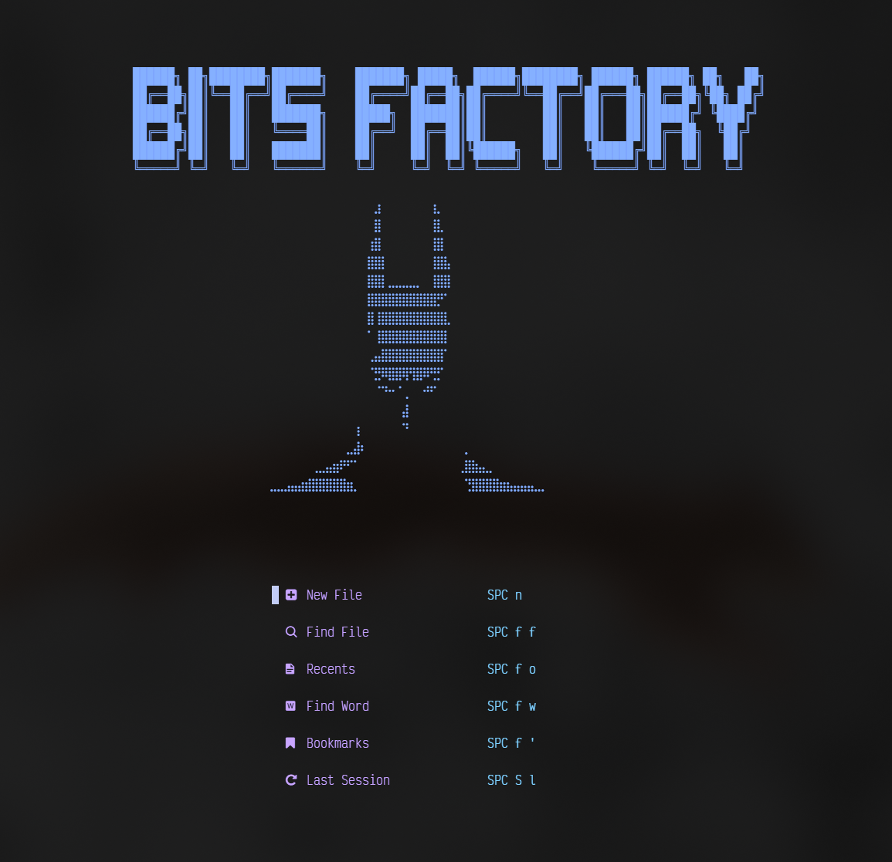
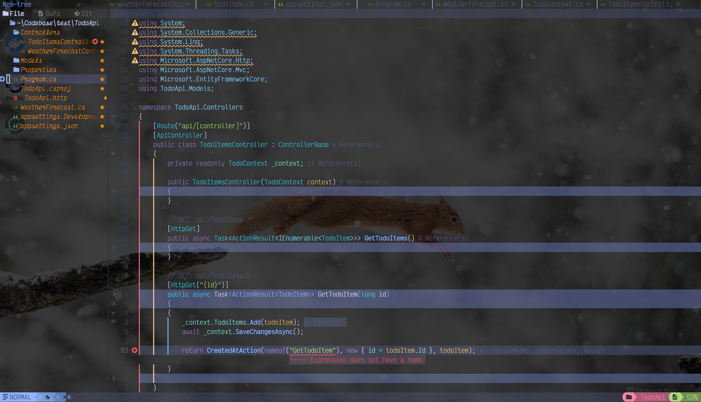

# AstroNvim v6 Personal Configuration

A comprehensive, modern Neovim configuration built on [AstroNvim v6](https://github.com/AstroNvim/AstroNvim), optimized for development workflows with AI assistance, debugging, formatting, linting, and a polished UI.

## Screenshots

### Startup Dashboard


### Editor Interface


## Version Information

- **AstroNvim**: v6.x
- **Neovim**: 0.11.0+ required
- **Branch**: `astronvim6-modern-ui` (current)
- **Previous versions**: `astrovim5`, `astrovim4`, `astrovim3` branches

## Prerequisites

### Required

| Tool | Version | Purpose |
|------|---------|---------|
| [Neovim](https://github.com/neovim/neovim/releases) | **0.11.0+** | Editor (v0.10 is NOT supported by AstroNvim v6) |
| [Git](https://git-scm.com/) | 2.x+ | Plugin management and version control |
| [Nerd Font](https://www.nerdfonts.com/) | Any | Icons and glyphs (CaskaydiaCove, JetBrainsMono, or VictorMono recommended) |
| [ripgrep](https://github.com/BurntSushi/ripgrep) | Latest | Live grep / content search |
| [fd](https://github.com/sharkdp/fd) | Latest | File finder |

### Recommended

| Tool | Purpose |
|------|---------|
| [WezTerm](https://wezfurlong.org/wezterm/) | Terminal emulator with rich rendering |
| [Nushell](https://www.nushell.sh/) | Modern cross-platform shell |
| [Starship](https://starship.rs/) | Fast, customizable prompt |
| [lazygit](https://github.com/jesseduffield/lazygit) | Git TUI (used by snacks.lazygit) |
| [Node.js](https://nodejs.org/) | Required for Copilot, some LSPs, and prettierd |
| [Python](https://www.python.org/) | Required for Python LSP/DAP |
| [Go](https://go.dev/) | Required for Go LSP/DAP |

### Installing Prerequisites

**Windows (Scoop):**
```powershell
scoop install neovim ripgrep fd fzf lazygit bat eza zoxide jq delta nushell starship
scoop bucket add nerd-fonts
scoop install CascadiaCode-NF
```

**Windows (Winget):**
```powershell
winget install Neovim.Neovim
winget install BurntSushi.ripgrep.MSVC
winget install sharkdp.fd
winget install jesseduffield.lazygit
winget install wez.wezterm
```

**macOS (Homebrew):**
```bash
brew install neovim ripgrep fd fzf lazygit bat eza zoxide jq git-delta nushell starship
brew install --cask wezterm font-caskaydia-cove-nerd-font
```

**Linux (apt + manual):**
```bash
# Neovim 0.11+ - use the official release or build from source
# https://github.com/neovim/neovim/releases
sudo apt install ripgrep fd-find fzf jq
# Install lazygit, nushell, starship from their official releases
```

### Verify Neovim Version

```bash
nvim --version
# Must show NVIM v0.11.0 or later
```

## Installation

### 1. Backup existing configuration

```bash
# Linux/macOS
mv ~/.config/nvim ~/.config/nvim.bak
mv ~/.local/share/nvim ~/.local/share/nvim.bak
mv ~/.local/state/nvim ~/.local/state/nvim.bak

# Windows (PowerShell)
Rename-Item ~/AppData/Local/nvim ~/AppData/Local/nvim.bak
Rename-Item ~/AppData/Local/nvim-data ~/AppData/Local/nvim-data.bak
```

### 2. Clone configuration

```bash
# Linux/macOS
git clone -b astronvim6-modern-ui https://github.com/Lilanga/astrovim-user.git ~/.config/nvim

# Windows (PowerShell)
git clone -b astronvim6-modern-ui https://github.com/Lilanga/astrovim-user.git ~/AppData/Local/nvim
```

### 3. Launch Neovim

```bash
nvim
```

AstroNvim will automatically install all plugins on first launch. Wait for the installation to complete.

### 4. Post-install health checks

Run these commands inside Neovim:

```vim
:Lazy sync
:checkhealth
:checkhealth vim.lsp
:checkhealth snacks
:Mason
:TSUpdate
```

### 5. Install LSP servers and tools

Open Neovim and run `:Mason` to install language servers and tools. The community packs will auto-install most tools, but verify these are present:

| Tool | Install via Mason | Purpose |
|------|-------------------|---------|
| `lua-language-server` | Auto | Lua LSP |
| `stylua` | Auto | Lua formatter |
| `typescript-language-server` | Auto | TypeScript/JavaScript LSP |
| `eslint-lsp` | Auto | JS/TS linting |
| `prettierd` | Auto | JS/TS/CSS/HTML formatting |
| `gopls` | Auto | Go LSP |
| `gofumpt` | Auto | Go formatter |
| `goimports` | Manual | Go import organizer |
| `delve` | Auto | Go debugger |
| `basedpyright` or `pyright` | Auto | Python LSP |
| `ruff` | Auto | Python linter/formatter |
| `debugpy` | Auto | Python debugger |
| `omnisharp` | Manual | C#/.NET LSP |
| `netcoredbg` | Manual | .NET debugger |
| `terraform-ls` | Auto | Terraform LSP |
| `tflint` | Manual | Terraform linter |
| `yamlls` | Auto | YAML LSP |
| `jsonls` | Auto | JSON LSP |
| `marksman` | Auto | Markdown LSP |
| `dockerls` | Auto | Docker LSP |

### 6. Copilot setup

```vim
:Copilot auth
```

Follow the GitHub authentication flow in your browser.

## Plugin Architecture

### UI Stack

| Layer | Plugin | Purpose |
|-------|--------|---------|
| Theme | `tokyonight.nvim` (primary), `catppuccin`, `rose-pine`, `kanagawa` | Colorschemes |
| Dashboard | `snacks.dashboard` | Startup screen with projects and git status |
| Notifications | `snacks.notifier` | Floating notifications |
| Command line | `noice.nvim` | Fancy cmdline, message routing, LSP messages |
| Statusline | Heirline (AstroNvim default) | Custom mode-aware statusline |
| Bufferline | `bufferline.nvim` | Visual buffer tabs |
| Indent guides | `snacks.indent` | Visual code structure |
| Smooth scroll | `snacks.scroll` | Animated scrolling |
| Smooth cursor | `SmoothCursor.nvim` | Mode-aware cursor animation |
| Zen mode | `snacks.zen` + `snacks.dim` | Distraction-free coding |
| Word highlight | `snacks.words` | Reference highlighting |

### Development Stack

| Layer | Plugin | Purpose |
|-------|--------|---------|
| LSP | AstroLSP + native `vim.lsp.config` | Language intelligence |
| Completion | AstroNvim default (blink.cmp/nvim-cmp) | Code completion |
| Formatting | `conform.nvim` | Format-on-save with per-filetype formatters |
| Linting | `nvim-lint` | Async linting on save/insert leave |
| Debugging | `nvim-dap` + `nvim-dap-ui` + `mason-nvim-dap` | DAP with auto-installed adapters |
| Diagnostics | `trouble.nvim` | Project-wide diagnostics panel |
| AI | GitHub Copilot + CopilotChat | Inline completion and chat |

### Navigation and Git

| Layer | Plugin | Purpose |
|-------|--------|---------|
| File finder | Telescope | Fuzzy file/grep/buffer search |
| File explorer | Neo-tree | Sidebar file browser |
| Git signs | gitsigns.nvim (AstroNvim default) | Inline git changes |
| Git blame | `snacks.git` | Blame line / blame file |
| Git TUI | `snacks.lazygit` | Lazygit floating terminal |
| Git diff | `diffview.nvim` | Side-by-side diff review |
| Motion | `flash.nvim` | Search-label navigation |

## Language Support

Pre-configured language packs (via AstroCommunity):

| Language | LSP | Formatter | Linter | Debugger |
|----------|-----|-----------|--------|----------|
| TypeScript/JavaScript | vtsls/tsserver | biome/prettierd/prettier | eslint_d | js-debug-adapter |
| Go | gopls | goimports + gofumpt | golangci-lint | delve |
| Python | basedpyright/pyright | ruff_format/black | ruff | debugpy |
| Lua | lua-language-server | stylua | - | - |
| C#/.NET | omnisharp/csharp-ls | csharpier | Roslyn analyzers | netcoredbg |
| Rust | rust-analyzer | rustfmt | clippy | codelldb |
| Terraform | terraform-ls | terraform_fmt | tflint | - |
| Docker | dockerls | - | hadolint | - |
| YAML | yamlls | prettier | yamllint | - |
| JSON | jsonls | jq/prettier | - | - |
| Markdown | marksman | prettier | markdownlint | - |
| Clojure | clojure-lsp | - | - | - |

## Key Mappings

### AI Assistant (`<leader>A` and `<leader>a`)

| Key | Description |
|-----|-------------|
| `<leader>Ace` | Enable Copilot |
| `<leader>Acd` | Disable Copilot |
| `<leader>Acs` | Copilot status |
| `<leader>ae` | Explain code (CopilotChat) |
| `<leader>ar` | Review code |
| `<leader>at` | Generate tests |
| `<leader>ac` | Open CopilotChat |
| `<leader>aq` | Quick chat |

### Debugging (`<leader>d`)

| Key | Description |
|-----|-------------|
| `<F5>` | Continue / Start |
| `<F10>` | Step over |
| `<F11>` | Step into |
| `<F12>` | Step out |
| `<leader>db` | Toggle breakpoint |
| `<leader>dB` | Conditional breakpoint |
| `<leader>du` | Toggle DAP UI |
| `<leader>dr` | Open REPL |
| `<leader>dl` | Run last config |
| `<leader>dt` | Terminate |
| `<leader>de` | Evaluate expression |

### Diagnostics (`<leader>x`)

| Key | Description |
|-----|-------------|
| `<leader>xx` | Toggle Trouble diagnostics |
| `<leader>xd` | Document diagnostics |
| `<leader>xw` | Workspace diagnostics |
| `<leader>xq` | Quickfix list |
| `<leader>xl` | Location list |
| `<leader>xr` | LSP references |

### Git (`<leader>g`)

| Key | Description |
|-----|-------------|
| `<leader>gg` | Lazygit |
| `<leader>gb` | Git blame (current line) |
| `<leader>gB` | Git blame (file) |
| `<leader>go` | Open in browser |

### Navigation

| Key | Description |
|-----|-------------|
| `fd` | Escape to normal mode |
| `<C-p>` | Find files |
| `<C-f>` | Live grep |
| `<Tab>` | Switch buffers |
| `<S-h>` / `<S-l>` | Previous / Next buffer |

### UI Toggles (`<leader>u`)

| Key | Description |
|-----|-------------|
| `<leader>uz` | Zen mode |
| `<leader>un` | Notification history |
| `<leader>uN` | Dismiss notifications |
| `<leader>n` | Zen mode (alt) |

## Configuration Structure

```
init.lua                    Bootstrap lazy.nvim
lua/
  lazy_setup.lua            AstroNvim v6 + lazy.nvim setup
  community.lua             AstroCommunity pack imports
  polish.lua                Post-setup autocmds
  theme-init.lua            Global theme system
  autocmd.lua               Shell, Neovide, diagnostics, cursor autocmds
  plugins/
    astrocore.lua           Options, diagnostics, keymaps
    astrolsp.lua            LSP configuration
    astroui.lua             UI/colorscheme settings
    ui-snacks.lua           snacks.nvim (dashboard, notifier, indent, scroll, zen, etc.)
    ui-noice.lua            noice.nvim command palette
    ui-theme.lua            Themes (TokyoNight, Catppuccin, Rose Pine, Kanagawa)
    formatting.lua          conform.nvim formatters
    linting.lua             nvim-lint linters
    dap.lua                 Debug Adapter Protocol
    git.lua                 Git workflow plugins
    copilot.lua             GitHub Copilot + CopilotChat
    heirline.lua            Custom statusline
    telescope.lua           Telescope + extensions
    neo-tree.lua            File explorer
    terminal.lua            Terminal (WezTerm/toggleterm)
    better-escape.lua       fd escape mapping
    grapple.lua             Buffer tagging
    init.lua                General plugins (which-key, aerial, surround, etc.)
  util/
    buffer.lua              Buffer navigation helpers
    color.lua               Color manipulation library
    dashboard_image.lua     ASCII art for dashboard
    macro.lua               Search and diagnostic helpers
    statusline.lua          Custom statusline providers
    theme.lua               Theme color extraction
```

## Customization

| What | Where |
|------|-------|
| Theme / colorscheme | `lua/plugins/ui-theme.lua` and `lua/plugins/astroui.lua` |
| Keymaps | `lua/plugins/astrocore.lua` (mappings section) |
| LSP settings | `lua/plugins/astrolsp.lua` |
| Formatters | `lua/plugins/formatting.lua` |
| Linters | `lua/plugins/linting.lua` |
| AI / Copilot | `lua/plugins/copilot.lua` |
| Dashboard | `lua/plugins/ui-snacks.lua` |
| Language packs | `lua/community.lua` |
| Debug adapters | `lua/plugins/dap.lua` |
| Terminal shell | `lua/plugins/terminal.lua` and `lua/autocmd.lua` |

## Troubleshooting

**Neovim version too old:**
AstroNvim v6 requires Neovim 0.11.0+. Check with `nvim --version`. Upgrade from the [official releases](https://github.com/neovim/neovim/releases).

**Plugin errors on first launch:**
Run `:Lazy sync` then restart Neovim. If errors persist, clear the plugin cache:
```bash
# Linux/macOS
rm -rf ~/.local/share/nvim/lazy
# Windows
Remove-Item -Recurse ~/AppData/Local/nvim-data/lazy
```

**LSP not starting:**
Run `:checkhealth vim.lsp` and `:Mason` to verify servers are installed. Use `:lsp` (v6 replacement for `:LspInfo`) to check active servers.

**Missing icons:**
Install a [Nerd Font](https://www.nerdfonts.com/) and set it as your terminal font. Recommended: CaskaydiaCove Nerd Font or JetBrainsMono Nerd Font.

**Copilot authentication:**
Run `:Copilot auth` and follow the browser flow. Check `:Copilot status` for connection status.

**Formatter not running:**
Run `:ConformInfo` to see which formatters are available for the current filetype. Install missing formatters via `:Mason`.

**Linter not running:**
Check that the linter binary is installed and on your PATH. Run `:checkhealth` for diagnostics.

## Contributing

Feel free to fork this configuration and adapt it to your needs. Pull requests are welcome.

## License

This configuration is open source and available under the MIT License.

---

*Built with [AstroNvim](https://github.com/AstroNvim/AstroNvim) v6 + [snacks.nvim](https://github.com/folke/snacks.nvim) + [noice.nvim](https://github.com/folke/noice.nvim)*
